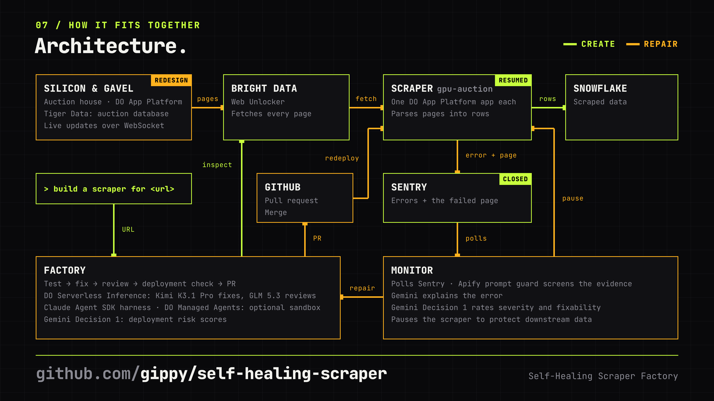

# Self-healing scraper factory

Give it a URL and it **builds a web scraper**, checks it against the live site, and deploys it. When the site
changes and the scraper breaks, a **monitor** notices in Sentry, pauses the scraper, and the factory **heals**
it: a failing test from the exact page that broke it, a fix, an adversarial review, a go/no-go decision on
probability thresholds, and a redeploy. A human steps in only when a check or the reviewer stops it.

**Demonstrated live (2026-11-13):** URL → generated scraper → merged PR → its own DigitalOcean app → rows in
Snowflake. After the site switched to a redesigned layout, the factory reproduced the failure from the exact
page, repaired and reviewed the parser, redeployed it, resumed scraping and resolved the Sentry issue. An
earlier repair that bent the parser toward wrong data was stopped by the reviewer and never shipped.

Built at the AIE x MLH Hackathon @ Code Summit (2026-11-13).

## Architecture



Lime is the create path: a URL goes to the factory, which inspects the site through Bright Data, opens a PR and
deploys a new scraper app that writes rows to Snowflake. Orange is the repair path: the site changes, the scraper
sends the error and the failed page to Sentry, the monitor pauses the scraper and hands it to the factory, and
the fix ships as a merged PR and a redeploy.

### How each service is used

| Service | What it does here |
|---|---|
| **DigitalOcean App Platform** | Hosts the auction house and every scraper, one app per scraper. The factory creates the app through the Apps API and triggers a redeploy after each merged heal. |
| **DigitalOcean Serverless Inference** | Runs the factory's agents on open-weight models through its Anthropic-compatible endpoint. |
| **DigitalOcean Managed Agents** | Optional agent runtime (`AGENT_RUNTIME=do-managed`): the agent works in a sandbox microVM and its changes come back as a patch. Proven live; the demonstrated heal ran on Serverless Inference. |
| **Gemini Decision 1** | Answers typed questions with probabilities: severity and fixability in the monitor's triage, and the ship or don't-ship gates in create and heal. Code applies the thresholds. |
| **Gemini 4 Hydrogen** | Reads a failing scraper's Sentry event and recent logs and explains in plain language what broke, for the dashboard and the triage. |
| **Gemini image generation** | Made the auction house's product photos once (`pnpm generate-images`). |
| **Sentry** | Scrapers report parser failures with the raw page attached, tagged with the scraper's name. The monitor polls it; the factory resolves the issue after the redeploy. |
| **Bright Data Web Unlocker** | Fetches every page, both when the factory investigates a site and on every scraper poll. |
| **Tiger Data** | The auction house's database. Every bid lands in the `bids` hypertable; the `lot_price_1m` continuous aggregate keeps each lot's highest bid and bid count per minute. |
| **Snowflake** | Scrapers write every poll to `SCRAPED_ITEMS`. The `LOT_PRICES` dynamic table turns that into one live row per lot (first price, latest price, growth), refreshed every minute. |
| **Apify prompt guard** | Screens fetched pages and Sentry events before any model reads them. Flagged or unchecked text never reaches a model. |
| **GitHub** | Every new scraper and every heal lands as a pull request on this repo; App Platform builds the scrapers from `main`. |
| **Claude Agent SDK** | The agent harness: runs the builder, fixer and reviewer agents, with a permission callback fencing their tools. |
| **Kimi K3.1 Pro** | Builder and fixer: writes new parsers with their tests and fixes broken ones. |
| **GLM 5.3** | Reviewer from a different lab: checks a new parser against the live page and tries to break each fix. |
| **MiniMax M3.1 Flash** | The harness's small model for side tasks. |

## The pieces

```
auction-house/  ──(Bright Data Web Unlocker)──▶  scrapers/<name>/  ──▶  Snowflake
 live demo site                                  one DigitalOcean app per scraper
 Tiger Data + WebSocket                          errors + raw page ──▶ Sentry
                                                                         │
factory/  ◀──────────────────────── monitor (Gemini) polls Sentry ◀──────┘
 create: investigate → generate → verify on the live site → Gemini gate → PR → deploy
 heal:   pause → failing test → fix → adversarial review → limits → Gemini gate → merge → redeploy → resume
```

| Folder | What it is |
|---|---|
| [`auction-house/`](auction-house/) | A live auction site: categories, bids that keep rising, lots selling, new lots appearing. State in **Tiger Data** (Postgres + TimescaleDB hypertable of bids), a simulation changing it every 2 s, server-rendered and updated live over a WebSocket. Its design can be switched on the fly (a redesign, new currency formats, a login wall, a CAPTCHA, a prompt-injection lot) to break scrapers on cue. Runs on **DigitalOcean App Platform**. |
| [`scraper-template/`](scraper-template/) | The runtime every scraper shares: fetch through **Bright Data**'s Web Unlocker, parse, write to **Snowflake**, report parser failures to **Sentry** with the raw page attached, pause and resume. The factory writes only `src/parsers/`. |
| `scrapers/<name>/` | Scrapers the factory built and deployed, one **DigitalOcean** app each. |
| [`analytics/`](analytics/) | What the data becomes. In **Snowflake**, a dynamic table turns every scrape into one live price per lot with its growth. In **Tiger Data**, a continuous aggregate keeps each lot's price per minute from the bids hypertable. |
| [`factory/`](factory/) | The monitor, the factory and the dashboard. |

## How the factory stays honest

The point is a factory you can trust to ship without a human, so every judgement a model makes is checked by
something that isn't that model:

- **Tests first.** Heal mode saves the exact page the parser failed on and must write a test that fails
  the way production did, checked by running it, before any fix. During the fix the test is read-only.
- **Two labs.** The fixer (Kimi K3.1 Pro) and the reviewer (GLM 5.3), both on **DigitalOcean Serverless
  Inference**, come from different labs, so the reviewer doesn't share the fixer's blind spots. The reviewer
  is told to break the fix: swallowed errors, `?.` that turns a crash into wrong data, weak tests, old layouts.
- **Verified on the live site.** Create mode fetches the site again, runs the new parser, checks the output
  in code (items, unique ids, titles, prices) and has the second model read the page and compare.
- **Probability thresholds enforced in code.** **Gemini Decision 1** answers typed questions with probabilities (risk, fixes the
  root cause, review clear; correct, complete, fails loudly). Code turns them into ship or don't, and the
  reviewer has a veto: a missing review or a blocking finding stops the merge whatever Gemini says.
- **Agents see only the scraper.** Each agent works in a sparse checkout of just its scraper's folder, so it
  learns the site from the pages it fetched, never from the site's source code in the same monorepo.
- **Limits in code.** A heal may only touch `src/parsers/` and `tests/`, at most 120 lines of production
  code, no dependencies or config. The agents' tools are fenced by a permission callback: writes only under
  allowed paths, a short list of exact commands, no shell chaining, no network. Model-written code runs
  with an environment holding no secrets.
- **Untrusted data stays data.** Pages and Sentry events go through **Apify**'s prompt guard before any
  model reads them; the CAPTCHA and injection layouts exist to show the pipeline refusing correctly.
- **Circuit breaker.** A broken scraper is paused at once, so no bad data reaches Snowflake while it heals.

## Built with

DigitalOcean (App Platform, Serverless Inference; Managed Agents as an optional agent runtime, proven live,
while the demonstrated heal ran on Serverless Inference) · Gemini (Decision 1, Gemini 4 Hydrogen, image generation) ·
Sentry · Bright Data · Tiger Data · Snowflake · Apify prompt guard · Claude Agent SDK as the agent harness.

## Run it

Each folder has its own README with every environment variable. In short:

```bash
cd auction-house && pnpm install && pnpm start          # http://localhost:8080, in memory without TIGER_DATABASE_URL
cd factory && pnpm install && POLL_SENTRY=1 pnpm start  # dashboard on http://localhost:8083
curl -X POST localhost:8083/scrapers -H "x-admin-secret: $ADMIN_SECRET" -H 'content-type: application/json' \
  -d '{"name":"auction-house","url":"https://<auction house URL>/"}'
```

[`DESIGN.md`](DESIGN.md) is the build contract the parallel agent sessions worked from; [`PLAN.md`](PLAN.md)
is how the idea evolved during the day.
